<p align="center">
  
</p>

<p align="center">
  <a href="https://github.com/ishandutta2007/Awesome-Awesome-Awesome"></a>
  <a href="https://discord.gg/jc4xtF58Ve"></a>
  <a href="https://github.com/ishandutta2007/Awesome-Release-Management/stargazers"></a>
  <a href="https://github.com/ishandutta2007/Awesome-Release-Management/network/members"></a>
  <a href="https://github.com/ishandutta2007/Awesome-Release-Management/blob/main/LICENSE"></a>
  <a href="https://github.com/ishandutta2007/Awesome-Release-Management/pulls"></a>
  <a href="https://github.com/ishandutta2007"></a>
</p>

---

# 🚀 Awesome Release Management

A comprehensive, production-tested, and SEO-optimized directory of **Application Release Orchestration (ARO)**, **Continuous Delivery (CD)** platforms, **GitOps release automation**, and **progressive delivery frameworks**. 

Whether you are an SRE, DevOps lead, Release Manager, or Platform Engineer looking to eliminate deployment blind spots, establish multi-environment release gates, orchestrate complex canary promotions, or enforce regulatory audit trails, this guide curates both the leading commercial SaaS platforms and premier open-source solutions.

---

## 📑 Table of Contents

- [🌐 Sector Overview & Market Dynamics](#-sector-overview--market-dynamics)
- [🏢 SaaS & Commercial Hosted Platforms](#-saas--commercial-hosted-platforms)
- [🔓 Open-Source GitHub Projects](#-open-source-github-projects)
- [🔍 Key Capabilities & Architectural Taxonomy](#-key-capabilities--architectural-taxonomy)
- [❓ Frequently Asked Questions (FAQ)](#-frequently-asked-questions-faq)
- [🤝 Support & Community](#-support--community)
- [📈 Star History](#-star-history)
- [🛠️ How to Contribute](#️-how-to-contribute)
- [⚖️ Disclaimer](#-disclaimer)

---

## 🌐 Sector Overview & Market Dynamics

The global **Application Release Orchestration (ARO) and Release Management** market was valued at approximately **$4.8 Billion in 2024** and is projected to expand to **$13.2 Billion by 2031**, progressing at an estimated Compound Annual Growth Rate (CAGR) of **19.4%**. 

The sector is **moderately fragmented**: hyperscale suite vendors (Microsoft, ServiceNow, Atlassian, GitLab) control broad cross-enterprise distribution and compliance governance, while specialized best-of-breed release orchestration and GitOps innovators (Harness, Octopus Deploy, Akuity) capture cloud-native Kubernetes workloads and progressive delivery deployments, preventing a single winner-take-all monopoly.

---

## 🏢 SaaS & Commercial Hosted Platforms

The following table evaluates premier enterprise SaaS release orchestration and continuous delivery platforms. The table is sorted in **descending order by company size** (market capitalization for publicly traded corporations, or verified private equity/venture valuation and annual recurring revenue).

| 🏢 Platform / Product | 🎯 Primary Focus & Strengths | 💰 Company Size (Valuation / Revenue) | 🏷️ Starting Tier Pricing | 🎁 Free Tier & Free Trial Limits |
| :--- | :--- | :--- | :--- | :--- |
| **[Azure Pipelines](https://azure.microsoft.com/en-us/products/devops/pipelines)** | End-to-end multi-stage release pipelines, cross-cloud orchestration (Azure, AWS, GCP), gated release approvals, and native integration with Azure Boards and GitHub Enterprise. | **~$3.1 Trillion** Market Cap *(Microsoft • Annual Revenue: >$245B)* | **$40/mo** per additional Microsoft-hosted parallel job (`$15/mo` per additional self-hosted parallel job; Azure DevOps Basic starts at `$6/user/mo` beyond 5 users) | **Free forever for up to 5 users**. Includes 1 Microsoft-hosted parallel job with **1,800 build minutes/month** (max 60 minutes per job) and 1 self-hosted parallel job with **unlimited minutes**. |
| **[ServiceNow Release Management](https://www.servicenow.com/)** | Enterprise ITIL release governance, automated change velocity gates, audit-proof deployment schedules, and risk-assessment integration connecting Jira, GitLab, and Jenkins into ServiceNow ITSM. | **~$185 Billion** Market Cap *(ServiceNow Inc. • Annual Revenue: ~$10.0B)* | **~$70 – $100/fulfiller agent/month** for baseline ITSM Foundation and DevOps Change Velocity modules (enterprise contracts typically require **$10,000+/year** minimum commitment) | **No public self-serve free trial**. Enterprise evaluations require a guided sales Proof-of-Concept (PoC). Free **Personal Developer Instances (PDIs)** are accessible via the ServiceNow Developer Program (hibernates after 2 hours idle; reclaimed after 10 days inactive). |
| **[Atlassian Bamboo](https://www.atlassian.com/software/bamboo)** | Enterprise deployment environments, release version branching, automated deployment trigger rules, and deep bidirectional traceability linking Jira issues, Confluence pages, and Bitbucket commits. | **~$48 Billion** Market Cap *(Atlassian Corporation • Annual Revenue: ~$4.4B)* | **$10 one-time starter license** for Bamboo Server (capped at 10 jobs, unlimited local agents, 0 remote agents); Bamboo Data Center starts at **$1,200/year** (includes 1 remote agent) | **30-day fully functional free trial** for Bamboo Data Center. No permanent free tier; instances lock into read-only mode upon trial expiration unless an active commercial license key is applied. |
| **[GitLab](https://about.gitlab.com/)** | Unified DevOps platform featuring built-in release milestones, environments, protected deployment branches, merge trains, release evidence generation, and progressive rollouts. | **~$8.8 Billion** Market Cap *(GitLab Inc. • Annual Revenue: ~$750M)* | **$29/user/month** (GitLab Premium tier, billed annually at `$348/user/year`; unlocks multi-project pipelines, merge trains, and enterprise agile release controls) | **Free forever plan for up to 5 users** per top-level group. Includes **400 CI/CD compute minutes/month** on shared runners, 10 GiB storage/namespace, and access to a **30-day GitLab Ultimate free trial**. |
| **[Harness](https://www.harness.io/)** | AI-driven release orchestration, automated canary verification (integrating Datadog, Prometheus, Splunk), automated rollback triggers, governance policies (OPA), and GitOps deployment pipelines. | **~$3.7 Billion** Valuation *(Series D • $150M+ ARR)* | **~$100/service/month** for Harness Continuous Delivery (CD) Team tier, or via modular consumption pools using Harness Subscription Units (HSUs) | **Free forever plan** including **2,000 Cloud credits/month**, community support, and core CI/CD & GitOps pipeline execution. Also provides a **14-day fully featured Enterprise free trial**. |
| **[CircleCI](https://circleci.com/)** | Cloud-native release automation with matrix deployment workflows, reusable Orbs, approval gates, test-splitting optimization, and multi-cloud environment promotions. | **~$1.7 Billion** Valuation *(Series F • $100M+ ARR)* | **$15/month** (Performance plan base, includes 30,000 monthly credits with pay-as-you-go overages at `$0.0006/credit` across custom machine classes) | **Free forever plan for up to 5 active users**. Includes **30,000 credits/month** (~3,000 build minutes on standard Linux Medium runner), up to **30 concurrent jobs**, and 2 GB storage. |
| **[CloudBees](https://www.cloudbees.com/)** | Scalable enterprise delivery platform built on Jenkins core, offering multi-controller orchestration, automated compliance controls, release risk scoring, and feature flag management. | **~$1.0 Billion** Valuation *(Private Equity backed • $150M+ ARR)* | **$30/month** (CloudBees Platform Team tier base; full enterprise seat licensing ranges between **$75 – $100/user/month** with annual minimums starting at $10k+) | **Free forever tier for up to 5 users**. Includes **2,000 execution minutes/month**, 100,000 feature management client-side users (CSUs), and 7-day log retention; plus a **14-day Enterprise trial**. |
| **[Octopus Deploy](https://octopus.com/)** | Specialized deployment automation and release management platform supporting complex runbooks, multi-tenant releases, environment progression matrices, and rolling/canary/blue-green deployments. | **~$1.0 Billion** Valuation *(Insight Partners backed • $100M+ ARR)* | **$104/project/year** for Octopus Server Professional (self-hosted); Octopus Cloud platform base starts at **$2,250/year** (includes 5 concurrent deployment tasks) | **Free forever plan** for up to **10 deployment targets/machines, 10 projects, 10 tenants, 10 users, and 1 space** (Cloud requires ≥1 deployment per 60 days). Also offers a **30-day Enterprise free trial**. |
| **[Digital.ai Release](https://digital.ai/products/release/)** | Enterprise release orchestration (formerly XebiaLabs XL Release) with cross-team calendar dependency visualization, automated audit packaging, compliance guardrails, and value stream delivery tracking. | **~$1.0 Billion+** Valuation *(TPG Capital owned • ~$250M Annual Revenue)* | **~$1,500/month** (Release SaaS baseline entry tier; custom quoted and billed annually based on applications and pipeline orchestrators) | **30-day fully functional SaaS cloud sandbox trial**. Provides pre-configured release templates, toolchain integrations, and environment pipelines (no permanent free tier). |
| **[Akuity Platform](https://akuity.io/)** | Fully managed enterprise control plane for Argo CD and Kargo, delivering unified multi-cluster GitOps orchestration, automated stage promotions, multi-tenant RBAC, and AI-assisted troubleshooting. | **~$150 Million** Valuation *(Series A • Decibel & Foundation Capital)* | **$495/month** (Pro plan base; includes 1 managed Argo CD instance, 1 Kargo instance, 50 Argo applications, 50 Kargo promotion stages, and 25M AI tokens/month) | **14-day fully featured Pro free trial** with unlimited connected Kubernetes clusters, automated GitOps syncing, and stage promotion pipelines (no permanent free tier). |

---

## 🔓 Open-Source GitHub Projects

The following list curates top open-source projects for self-hosted release management, GitOps continuous delivery, versioning automation, and progressive rollouts. The list is **strictly sorted in descending order by GitHub Stars_Count**. Each repository displays its official live GitHub Stars_Count badge linking directly to its stargazers page.

1. **[Drone](https://github.com/drone/drone)** [](https://github.com/drone/drone/stargazers)  
   *Container-native continuous delivery and release automation server (Apache 2.0).* Executes each pipeline step inside an isolated Docker container with zero host-level dependency pollution. Features YAML-based delivery pipelines, environment promotion gates, approval steps, and native integrations with GitHub, GitLab, and Gitea.

2. **[Jenkins](https://github.com/jenkinsci/jenkins)** [](https://github.com/jenkinsci/jenkins/stargazers)  
   *The foundational open-source automation and release server (MIT).* Powers thousands of enterprise release workflows through declarative and scripted Groovy Pipelines. With over 1,800 plugins (including Release, Blue Ocean, Pipeline Milestone, and Credentials Binding), Jenkins coordinates cross-platform deployments across bare metal, virtual machines, and container clusters.

3. **[Argo CD](https://github.com/argoproj/argo-cd)** [](https://github.com/argoproj/argo-cd/stargazers)  
   *Declarative, Kubernetes-native GitOps continuous delivery tool (CNCF Graduated, Apache 2.0).* Continuously monitors declarative Git repositories (Helm, Kustomize, plain manifests) and reconciles live cluster state against the declared target. Features real-time drift detection, automated self-healing, multi-cluster control plane management, SSO/RBAC, and a rich visualization web UI.

4. **[semantic-release](https://github.com/semantic-release/semantic-release)** [](https://github.com/semantic-release/semantic-release/stargazers)  
   *Fully automated version management and package publishing framework (MIT).* Completely eliminates human intervention in the release lifecycle by parsing commit messages according to the Conventional Commits specification. Automatically determines the next semantic version number (major, minor, patch), generates release notes/changelogs, creates git tags, and publishes distribution packages across package registries.

5. **[GoReleaser](https://github.com/goreleaser/goreleaser)** [](https://github.com/goreleaser/goreleaser/stargazers)  
   *Automated cross-compilation and release delivery tool (Apache 2.0).* Builds Go binaries for multiple architectures, packages them into Docker images, Homebrew taps, RPM/DEB distributions, and Snapcraft packages, and publishes checksummed assets and signed release notes directly to GitHub Releases, GitLab Releases, or custom artifact repositories.

6. **[Spinnaker](https://github.com/spinnaker/spinnaker)** [](https://github.com/spinnaker/spinnaker/stargazers)  
   *Enterprise multi-cloud continuous delivery and release platform (Apache 2.0).* Originally developed by Netflix, Spinnaker coordinates complex, highly resilient deployments across AWS EC2, Google Cloud Platform, Microsoft Azure, and Kubernetes. Features automated canary analysis (Kayenta), blue/green (red/black) rollouts, rolling deployment strategies, and manual judgment promotion gates.

7. **[Atlantis](https://github.com/runatlantis/atlantis)** [](https://github.com/runatlantis/atlantis/stargazers)  
   *Pull-request driven Terraform and OpenTofu release automation tool (Apache 2.0).* Streamlines infrastructure release management by running `terraform plan` and `terraform apply` directly within GitHub, GitLab, or Bitbucket PR comments. Enforces mandatory approval policies, state locking across branches, and transparent infrastructure audit trails prior to merging into production.

8. **[Tekton Pipelines](https://github.com/tektoncd/pipeline)** [](https://github.com/tektoncd/pipeline/stargazers)  
   *Standardized, cloud-native CI/CD and release pipeline primitives for Kubernetes (CNCF Graduated, Apache 2.0).* Defines release workflows as reusable Kubernetes Custom Resource Definitions (`Tasks`, `Pipelines`, `PipelineRuns`). Serves as the underlying engine for enterprise delivery systems like Red Hat OpenShift Pipelines and Konflux.

9. **[release-it](https://github.com/release-it/release-it)** [](https://github.com/release-it/release-it/stargazers)  
   *Interactive CLI tool and build-pipeline release automator (MIT).* Automates semantic version bumping, git commit/tagging/pushing, release notes generation, package publishing (npm, PyPI, Maven, etc.), and GitHub/GitLab release creation. Supports interactive CLI prompts for manual control or automated execution in CI/CD environments.

10. **[Flux 2](https://github.com/fluxcd/flux2)** [](https://github.com/fluxcd/flux2/stargazers)  
    *Composable, multi-tenant GitOps continuous delivery engine for Kubernetes (CNCF Graduated, Apache 2.0).* Built from the ground up using the Kubernetes API and controller runtime. Leverages GitRepository, OCI, and HelmRepository sources to orchestrate continuous deployment, automated image update automation, and progressive multi-cluster delivery.

11. **[Woodpecker CI](https://github.com/woodpecker-ci/woodpecker)** [](https://github.com/woodpecker-ci/woodpecker/stargazers)  
    *Community-driven, container-based continuous integration and deployment engine (Apache 2.0).* A community fork of Drone that executes pipeline workflows inside isolated containers. Features a lightweight footprint, declarative pipeline syntax, environment promotions, multi-arch support, and zero vendor lock-in.

12. **[Release Please](https://github.com/googleapis/release-please)** [](https://github.com/googleapis/release-please/stargazers)  
    *Automated release PR and versioning bot developed by Google (Apache 2.0).* Analyzes Conventional Commits across git history to maintain a dedicated "Release PR". Automatically updates changelog files and version bumps across multiple languages and monorepos, triggering asset builds and package releases only when the Release PR is approved and merged.

13. **[GoCD](https://github.com/gocd/gocd)** [](https://github.com/gocd/gocd/stargazers)  
    *Continuous delivery server with first-class Value Stream Mapping (Apache 2.0).* Specialized in modeling complex delivery pipelines with sequential and parallel dependencies, fan-in/fan-out dependency trees, environment promotion gates, and end-to-end cryptographic traceability from code commit to production deployment.

14. **[Flagger](https://github.com/fluxcd/flagger)** [](https://github.com/fluxcd/flagger/stargazers)  
    *Progressive delivery Kubernetes operator (CNCF Flux Project, Apache 2.0).* Automates release promotions for Kubernetes workloads using Istio, Linkerd, Contour, Gloo, or NGINX service meshes. Executes automated Canary, A/B Testing, and Blue/Green rollouts with metric-based analysis against Prometheus, Datadog, or New Relic, triggering automatic rollback on anomaly detection.

15. **[Kargo](https://github.com/akuity/kargo)** [](https://github.com/akuity/kargo/stargazers)  
    *Cloud-native GitOps release promotion lifecycle manager (Apache 2.0).* Created by the founders of Argo CD, Kargo bridges the gap between CI and GitOps delivery. Models multi-environment promotion pipelines (e.g., Dev → Test → Staging → Prod), tracking release candidate artifacts (images, Helm charts, git revisions) across sequential stages with automated health verification and approval gates.

16. **[Argo Rollouts](https://github.com/argoproj/argo-rollouts)** [](https://github.com/argoproj/argo-rollouts/stargazers)  
    *Progressive delivery controller for Kubernetes (CNCF Graduated, Apache 2.0).* Replaces the default Kubernetes Deployment object with an advanced `Rollout` CRD. Provides automated canary and blue/green rollouts, integrated metric analysis (Prometheus, Datadog, CloudWatch), automated rollbacks, and traffic routing via ingress controllers and service meshes.

17. **[Keptn](https://github.com/keptn/keptn)** [](https://github.com/keptn/keptn/stargazers)  
    *Cloud-native application lifecycle orchestrator (CNCF Incubating, Apache 2.0).* Bridges release orchestration and Site Reliability Engineering (SRE). Uses Service Level Indicators (SLIs) and Service Level Objectives (SLOs) to automate release verification, deployment evaluations, and self-healing actions.

18. **[PipeCD](https://github.com/pipe-cd/pipecd)** [](https://github.com/pipe-cd/pipecd/stargazers)  
    *Unified GitOps continuous delivery system for multi-cloud and heterogeneous targets (CNCF Sandbox, Apache 2.0).* Provides a single control plane for deploying Kubernetes, Terraform, GCP Cloud Run, AWS Lambda, and AWS ECS. Features built-in deployment analysis, zero deployment credentials exposed outside the cluster, and automatic tracking of DORA metrics.

19. **[Konflux](https://github.com/konflux-ci/konflux-ci)** [](https://github.com/konflux-ci/konflux-ci/stargazers)  
    *Software supply chain-secure release platform built on Tekton (Apache 2.0).* Designed to produce tamper-proof software artifacts by generating in-toto attestations, SLSA provenance records, and cryptographic Cosign signatures before promoting container images and binaries into enterprise production registries.

---

## 🔍 Key Capabilities & Architectural Taxonomy

```
+-----------------------------------------------------------------------------------+
|                        APPLICATION RELEASE MANAGEMENT                             |
+-----------------------------------------------------------------------------------+
        |                                                 |
        v                                                 v
+-----------------------------+                 +-----------------------------+
|    ENTERPRISE GOVERNANCE    |                 |     DELIVERY ORCHESTRATION  |
+-----------------------------+                 +-----------------------------+
| • Change Risk Assessment    |                 | • Multi-Stage Pipelines     |
| • ITIL Compliance Gates     |                 | • GitOps Desired State Sync |
| • Release Calendars & Trays |                 | • Progressive Delivery      |
| • Audit Evidence Trail      |                 | • Automated Canary Rollback |
+-----------------------------+                 +-----------------------------+
        |                                                 |
        +-----------------------+-------------------------+
                                |
                                v
                +-------------------------------+
                |   VERIFICATION & OBSERVABILITY |
                +-------------------------------+
                | • Prometheus & Datadog SLI/SLO|
                | • Automated Health Rollbacks  |
                | • DORA Metrics Tracking       |
                | • Cosign / SLSA Attestations  |
                +-------------------------------+
```

### 1. Enterprise Release Governance vs. Continuous Deployment
* **Release Governance**: Focuses on *when*, *why*, and *with what authority* code reaches production environments. Platforms like **ServiceNow Release Management** and **Digital.ai Release** integrate with ITSM change request databases to guarantee regulatory compliance (SOX, HIPAA, SOC 2).
* **Delivery Orchestration**: Focuses on *how* software artifacts transition between environments. Solutions like **Octopus Deploy**, **GitLab**, and **Azure Pipelines** model environment dependencies, secret management, and manual judgment promotion gates.

### 2. GitOps Continuous Delivery
* **Git as the Single Source of Truth**: Declarative infrastructure and application state are stored in Git repositories. Tools like **Argo CD** and **Flux 2** monitor clusters and eliminate configuration drift automatically.
* **Stage Promotion Managers**: Tools like **Kargo** layer on top of GitOps to manage the sequential progression of git tags and container digests across multiple environments (Dev → Staging → Production).

### 3. Progressive Delivery & Canary Automation
* **Traffic Splitting**: Directs a small fraction of user traffic (e.g., 5% → 25% → 100%) to canary versions using service meshes or ingress controllers.
* **Automated Verification**: **Argo Rollouts** and **Flagger** evaluate live Prometheus or Datadog metrics (HTTP 5xx error rates, P99 latency); if thresholds are violated, the rollout aborts and rolls back immediately without human intervention.

---

## ❓ Frequently Asked Questions (FAQ)

### What is modern Release Management?
Modern Release Management is the discipline of planning, scheduling, orchestrating, and governing software deployments across environments. Unlike traditional manual quarterly release cycles, modern release management leverages automated pipelines, GitOps continuous delivery, progressive rollouts (canary/blue-green), and automated risk evaluation to enable multiple safe production deployments per day.

### What is the difference between CI/CD and Release Management?
* **CI/CD (Continuous Integration & Continuous Delivery)** focuses on compiling, testing, packaging, and deploying code artifacts automatically upon git commits.
* **Release Management** sits at a higher orchestration layer: coordinating multi-service dependencies, scheduling release windows, enforcing business and regulatory approvals, managing environment configurations, and tracking cross-functional rollout readiness.

### When should our team choose GitOps over traditional pipeline delivery?
* **Choose GitOps (Argo CD, Flux 2)** when managing Kubernetes workloads across multiple clusters, requiring tamper-proof audit trails of cluster state in Git, and wanting automated drift correction.
* **Choose Pipeline Orchestrators (Octopus Deploy, Harness, Azure Pipelines)** when deploying heterogeneous workloads (bare metal, legacy VMs, serverless, database migrations) with complex manual approval matrices and enterprise calendar dependencies.

---

## 🤝 Support & Community

If you find this curated directory useful for your engineering, DevOps, and platform teams, please consider supporting the project:

- ⭐ **Star this repository** on GitHub to help other engineers discover it.
- 🍴 **Fork the repo** to contribute additions, corrections, and tool insights.
- 📣 **Share with your team** and post about it on LinkedIn, X/Twitter, or developer communities.
- ☕ **Sponsor & Buy a Coffee**: Support continuous research and open-source curation via the [GitHub Sponsor Dashboard](https://github.com/sponsors/ishandutta2007).

Thank you for helping make release management transparent, reliable, and delivery-ready! 💖

---

## 📈 Star History

[](https://star-history.dera.aage/#ishandutta2007/Awesome-Release-Management&type=date&legend=top-left)

---

## 🛠️ How to Contribute

Contributions are welcome! To propose additions, updates, or corrections:

1. **Fork the repository** to your GitHub account.
2. **Create a branch** for your feature or tool addition (`git checkout -b add-tool-name`).
3. **Add or edit entries in `README.md`** following the existing tabular or badge format:
   - For SaaS tools: verify specific starting pricing, free tier/trial limits, and company valuation.
   - For Open-Source tools: include official repo URL, social Stars_Badge linked to `/stargazers`, and license information.
4. **Sort entries properly** according to the established criteria (Company Size for SaaS, GitHub_Stars for Open-Source).
5. **Submit a Pull Request (PR)** with a concise summary of the changes.

---

## ⚖️ Disclaimer

* This repository is a **community-curated informational list** and does not constitute formal endorsement.
* Pricing tiers, free tier limits, and corporate valuations change frequently; please verify current terms directly with vendor documentation.
* Tools managing production deployment credentials and cluster access must comply with internal security policies and regulatory frameworks (SOC 2, ISO 27001, HIPAA, GDPR).
